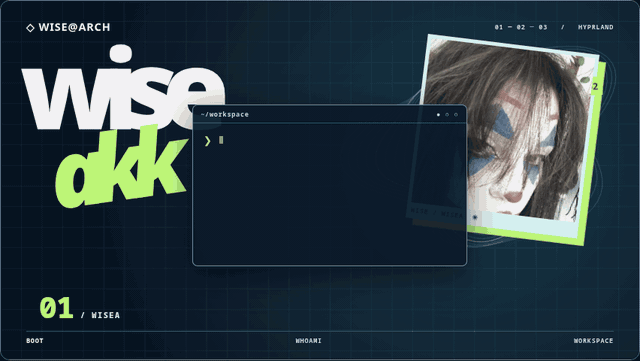
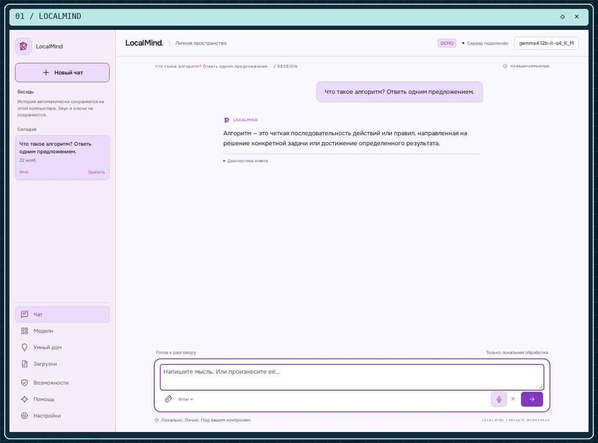
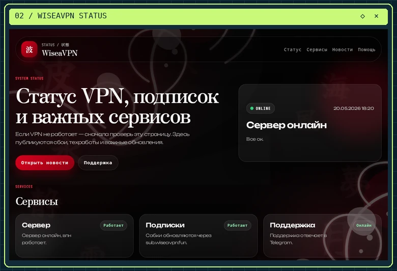

<picture>
  <source media="(max-width: 620px)" srcset="assets/wiseakk-hero-390.webp">
  <source media="(prefers-reduced-motion: reduce)" srcset="assets/wiseakk-hero-1100.webp">
  
</picture>

wise / wisea / wiseakk · Arch Linux · Hyprland · Python, C++, C# · learning Rust

## My projects

### LocalMind

*Your PC. Your AI. Your rules.*

A local AI assistant that can chat, understand your voice, and interact with your computer — all on your terms.

<picture>
  <source media="(max-width: 620px)" srcset="assets/localmind-project-mobile.webp">
  
</picture>

[Explore LocalMind ↗](https://github.com/wiseakk/LocalMind)

---

### WiseaVPN

*Private access. Fair price. Small community.*

An affordable VPN service built for a small community. Simple, reliable, and focused on keeping things accessible.

<picture>
  <source media="(max-width: 620px)" srcset="assets/wiseavpn-status-mobile.webp">
  
</picture>

[Visit WiseaVPN ↗](https://www.wiseavpn.fun/)
