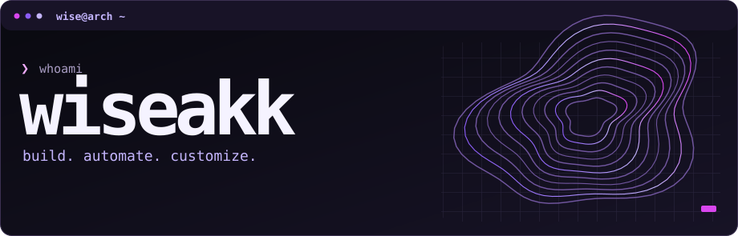
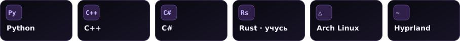
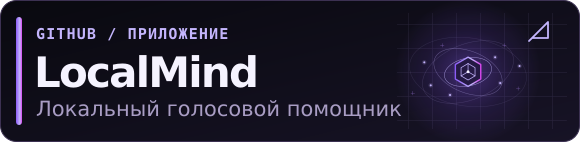
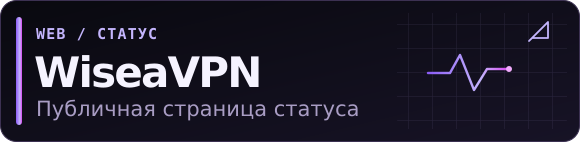

<picture>
  <source media="(max-width: 800px)" srcset="assets/terminal-mobile.svg">
  
</picture>

Привет, я **wise**. Ещё использую **wisea** и **wiseakk**. Пишу инструменты для своего Linux-окружения и экспериментирую с локальным AI и автоматизацией.

## Рабочее окружение

<picture>
  <source media="(max-width: 800px)" srcset="assets/stack-mobile.svg">
  
</picture>

## Избранное

## Вне кода

`Linux` &ensp; `Dota 2` &ensp; `Музыка`

---

[**@wiseakk**](https://github.com/wiseakk) &nbsp;·&nbsp; [Репозитории](https://github.com/wiseakk?tab=repositories) &nbsp;·&nbsp; [Обратная связь по LocalMind](https://github.com/wiseakk/LocalMind/issues)
